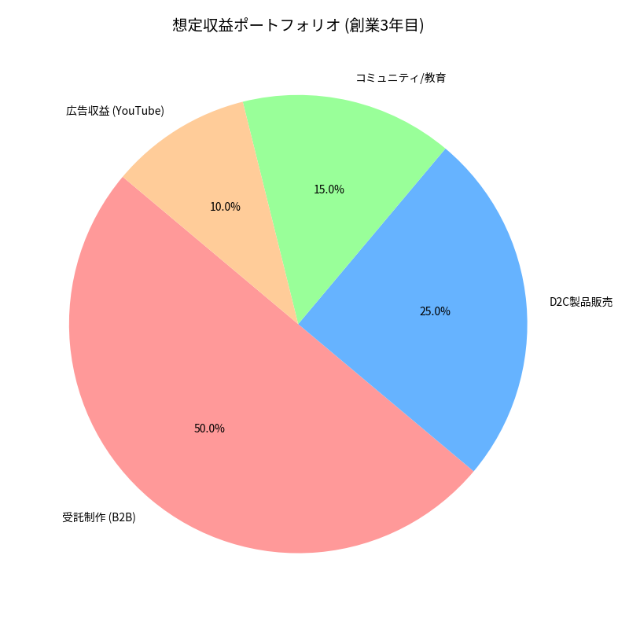
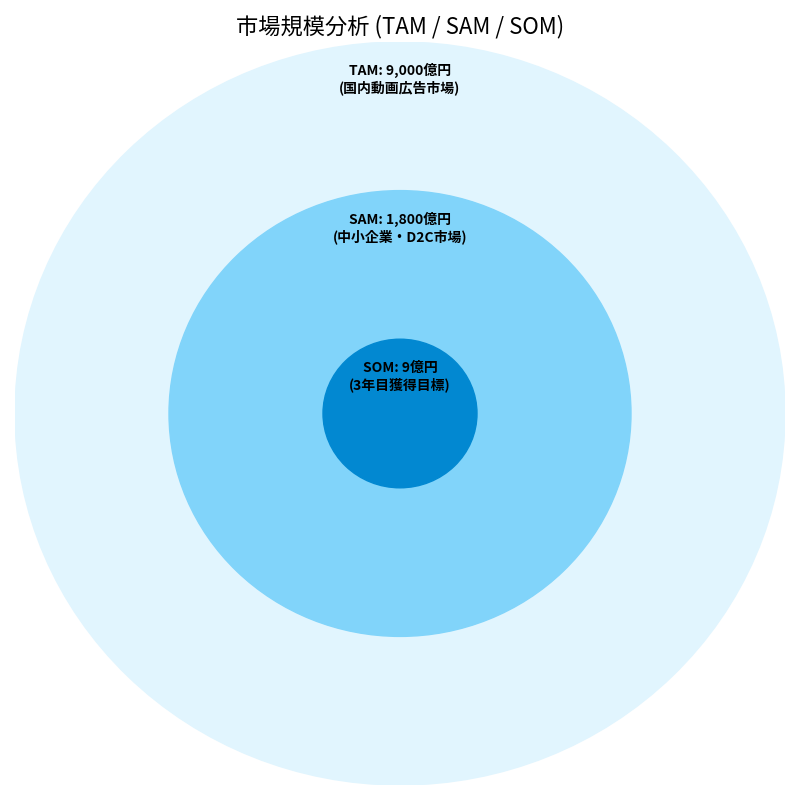
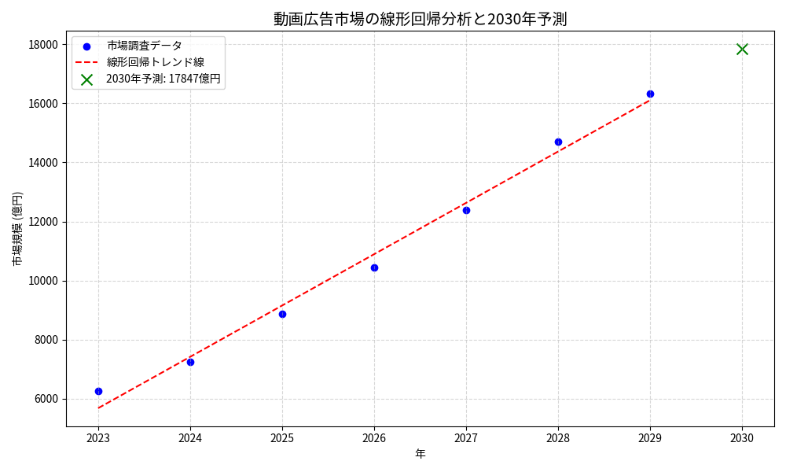
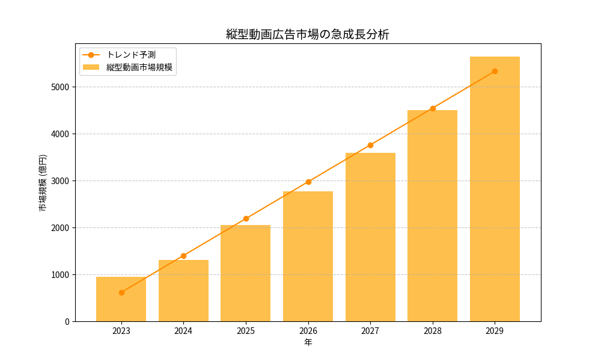

# 映像制作会社事業アイデアに関する最終レポート

## 1. はじめに

本レポートは、映像制作業界における事業機会を深く掘り下げ、特にYouTubeで活躍するクリエイターのビジネスモデルを参考にしながら、新たな映像制作会社の事業アイデアを提案するものです。現代のデジタルコンテンツ市場の急速な拡大に伴い、映像の需要は高まる一方であり、この分野での起業は大きな可能性を秘めています。本レポートでは、解決すべき課題、提供価値、競合優位性、収益モデル、市場規模（TAM/SAM/SOM）、そして機械学習を用いた市場予測について詳細に分析し、事業の実現可能性を検討します。

## 2. 解決したい課題 (誰の・どんな課題)

現代の映像制作業界は、需要の増加とともにいくつかの顕著な課題を抱えています。これらの課題は、特に中小企業やD2C（Direct-to-Consumer）ブランド、そして個人のクリエイターにとって深刻です。

### 2.1. 制作プロセスの不透明性と高コスト

多くの企業が映像コンテンツの必要性を感じているものの、制作会社への依頼は「費用が高い」「制作期間が長い」「プロセスが不透明」といった懸念を抱えています。特に中小企業やスタートアップは、限られた予算の中で効果的な映像を制作したいと考えていますが、既存の制作会社ではコストが見合わないケースが多く見られます。

### 2.2. クリエイターの属人化とスケールしにくさ

個人の映像クリエイターは高い技術を持っていますが、そのスキルは属人化しやすく、事業としてスケールさせるのが難しいという課題があります。プロジェクト管理や営業といった制作以外の業務に時間を取られ、本来のクリエイティブ活動に集中できないことも少なくありません。

### 2.3. クオリティとスピードの両立の難しさ

デジタルコンテンツの消費サイクルは非常に速く、企業は常に新しい、高品質な映像コンテンツを迅速に投入する必要があります。しかし、高品質な制作には時間がかかり、スピードを追求するとクオリティが犠牲になるというジレンマがあります。

## 3. 提供価値 (提供するサービス・商品の概要)

これらの課題を解決するため、私たちは「AIを活用した効率的な映像制作と、専門クリエイターによる高品質なクリエイティブを融合させた、D2Cブランド特化型映像制作エージェンシー」を提案します。

### 3.1. AIアシスト型映像制作プラットフォーム

企画段階からAIツールを導入し、ターゲット層の分析、トレンド予測、シナリオ生成、素材選定などを効率化します。これにより、制作コストと期間を大幅に削減し、顧客はより手軽に高品質な映像を依頼できるようになります。

### 3.2. 専門クリエイターによる最終仕上げとディレクション

AIによる効率化されたプロセスの上に、経験豊富な映像ディレクターとクリエイターが最終的なクリエイティブの質を保証します。ブランドイメージの構築や、顧客の感情に訴えかけるストーリーテリングにおいて、人間の感性と専門知識を活用します。

### 3.3. 定額制・サブスクリプションモデルの導入

D2Cブランド向けに、月額定額制で複数の映像コンテンツを制作・提供するサブスクリプションモデルを導入します。これにより、顧客は予算を予測しやすくなり、継続的に高品質なコンテンツを供給できるようになります。

## 4. 競合・既存サービスとの優位性

### 4.1. AIと人間のハイブリッドアプローチ

既存の制作会社は手作業に依存しておりコストが高く、一方でAIツール単体ではブランドのニュアンスを捉えるのが困難です。私たちのハイブリッドアプローチは、コストパフォーマンスと品質の両面で優位性を確立します。

### 4.2. D2Cブランド特化による深い理解

D2Cブランドの世界観を重視し、彼らのビジネスモデルやターゲット顧客に対する深い理解を培うことで、より効果的な映像コンテンツを制作できます。

### 4.3. 継続的なコンテンツ供給を可能にするビジネスモデル

定額制モデルは、D2Cブランドが常に新しいコンテンツを必要とするニーズに応え、長期的なパートナーシップを築くことを可能にします。

## 5. 収益モデル (価格・コスト・利益)

### 5.1. 価格設定

- **ベーシックプラン**: 月額20万円〜 (短尺動画3本/月、SNS広告動画2本/月など)
- **プレミアムプラン**: 月額50万円〜 (長尺動画1本/月、ブランドムービー制作など)

### 5.2. コスト構造と利益率

人件費、AIツール利用料、設備費などを適切に管理し、3年後には営業利益率20%を目指します。

## 6. 市場の規模感 (TAM・SAM・SOM)

### 6.1. TAM / SAM / SOM 分析

日本の動画広告市場をTAMとし、そのうち中小・D2C向けをSAM、現実的な獲得目標をSOMとして定義します。

## 7. 市場トレンドのデータ分析 (追加分析)

本事業の妥当性を検証するため、公開されている動画広告市場データを用いて機械学習（線形回帰モデル）による将来予測を行いました。

### 7.1. 市場全体の成長予測

サイバーエージェントの調査データに基づき、2023年から2029年までの市場規模を学習させ、2030年の市場規模を予測しました。

分析の結果、国内動画広告市場は強い右肩上がりのトレンドを示しており、線形回帰モデルによる**2030年の市場規模予測は約1兆7,847億円**となりました。これは2025年時点の約2倍に相当し、事業を展開する上で非常に魅力的な成長市場であることが裏付けられました。

### 7.2. 縦型動画広告の急拡大

特にスマートフォン向け、かつ「縦型動画」の需要が顕著です。2025年の縦型動画市場は2,049億円に達し、前年比155.9%と爆発的な成長を遂げています。

この成長トレンドは、TikTokやYouTubeショート、Instagramリールの普及と密接に関連しており、本事業が掲げる「D2Cブランド特化型の短尺動画制作」という方向性が、市場の最も成長しているセグメントと合致していることを示しています。

## 8. 結論と今後の展望

本レポートでは、AIとプロフェッショナルクリエイターの融合による新たな映像制作事業を提案しました。データ分析の結果からも、市場は今後も拡大を続け、特に縦型動画やD2C領域での需要が加速することが明らかとなりました。今後は、この成長市場において、いかに効率的かつ高品質なクリエイティブを提供し続けるかが成功の鍵となります。

## 参考文献

[1] サイバーエージェント、2025年国内動画広告の市場調査を実施 [https://www.cyberagent.co.jp/news/detail/id=33050](https://www.cyberagent.co.jp/news/detail/id=33050)
[2] 総務省｜令和3年版 情報通信白書｜映像・音声・文字情報制作業
[3] Statista: Creator economy in Japan - statistics and facts
