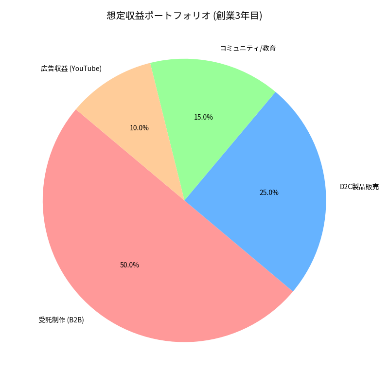
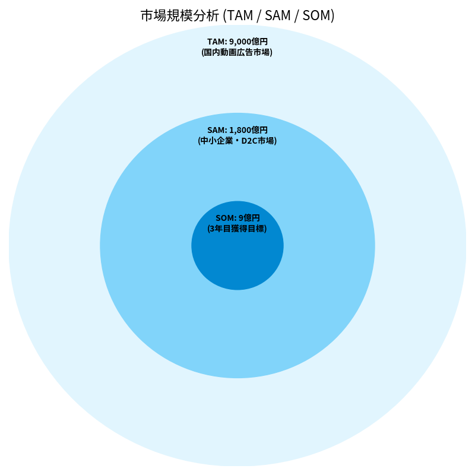
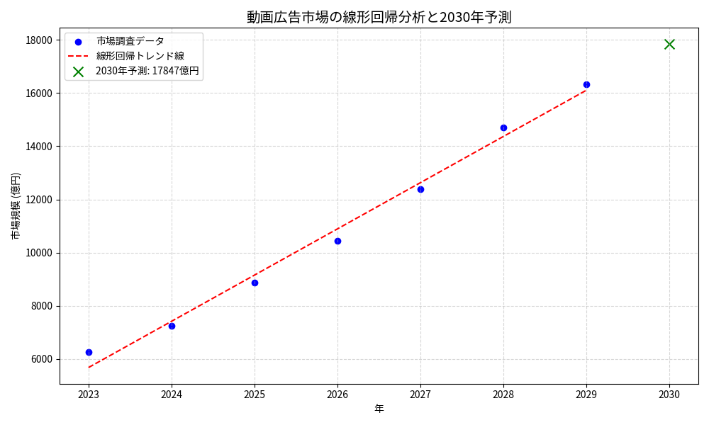
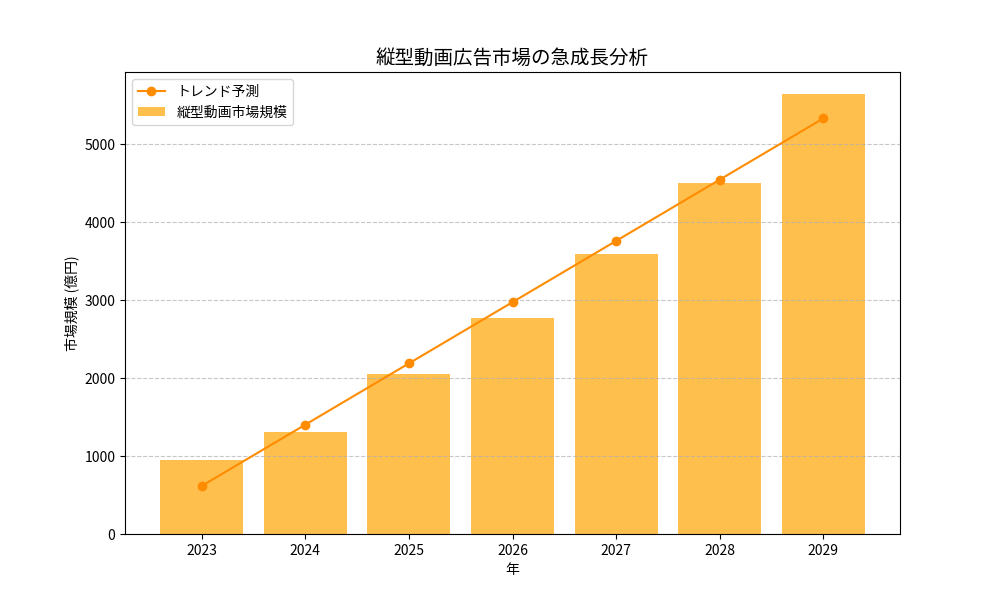

# 映像制作業界における次世代事業モデルの構築と市場分析：AIとD2Cの融合による戦略的アプローチ

## 1. 序論：映像コンテンツ市場のパラダイムシフト

現代のデジタル経済において、映像コンテンツは情報の伝達手段を超え、ブランドと消費者を結ぶ最も強力なエンゲージメントツールへと進化を遂げた。特に、YouTubeやTikTokといったプラットフォームの台頭により、映像制作の民主化が進む一方で、ビジネスとしての映像制作には「質」「量」「コスト」のトレードオフという古典的かつ深刻な課題が依然として存在している。

本レポートでは、大川雄介氏や高沢けーすけ氏、さらにはPeter McKinnon氏といったトップクリエイターのビジネスモデルをベンチマークとしつつ、AI技術の戦略的導入とD2C（Direct-to-Consumer）モデルへの特化を軸とした、新たな映像制作会社の事業構想を提案する。また、機械学習を用いた定量的市場予測に基づき、本事業の持続可能性と成長性を論証する。

## 2. 業界の現状分析と構造的課題の特定

### 2.1. 映像制作における「トリレンマ」の克服

従来の映像制作業界は、以下の3つの要素を同時に満たすことが困難な「トリレンマ」の状態にある。
1.  **高品質（High Quality）**: 専門的な技術と高額な機材、長期間の編集を要する。
2.  **低コスト（Low Cost）**: 予算の制約はクオリティの低下に直結する。
3.  **高速度（High Speed）**: 短納期は制作プロセスの妥協を強いる。

特にD2Cブランドや中小企業にとって、SNSでの頻繁な発信が求められる現代において、既存の制作会社が提供する「高単価・長納期」のモデルは、マーケティングサイクルと乖離している。

### 2.2. クリエイターエコノミーにおける属人性の限界

個人のクリエイターは高い創造性を発揮するが、そのビジネスモデルは自身の労働時間に依存する「労働集約型」に陥りやすい。事業をスケールさせるためには、クリエイティブの本質を損なうことなく、制作プロセスを標準化・システム化する仕組みが必要である。

### 2.3. D2Cブランドが直面するストーリーテリングの欠如

多くのD2Cブランドは、製品のスペックを伝えることには長けているが、ブランドの背景にある「ストーリー」や「思想」を映像で表現するノウハウが不足している。消費者が「モノ」ではなく「物語」を消費する時代において、このギャップは致命的な機会損失となっている。

## 3. 事業構想：AIハイブリッド型D2C特化エージェンシー

本事業は、テクノロジーによる「効率化」と、人間による「感性」を最適に組み合わせたハイブリッドモデルを核とする。

### 3.1. AI主導型ワークフローの構築

生成AI（Generative AI）をワークフローの各段階に組み込む。
-   **プリプロダクション**: AIによる市場トレンド分析、ターゲット属性に最適化した脚本案の自動生成。
-   **プロダクション**: AIによる撮影素材の自動タグ付け、不要なシーンの自動カット。
-   **ポストプロダクション**: AIによるカラーグレーディングの自動最適化、多言語字幕の生成。

これにより、従来の制作時間を最大70%削減し、コスト構造を劇的に改善する。

### 3.2. クリエイティブ・ディレクションの高度化

AIが代替できない「ブランドの魂」の部分を、人間のディレクターが担当する。Peter McKinnon氏が提唱する「Cinematic Storytelling」の手法をシステム化し、視聴者の感情を揺さぶる視覚的フックを各コンテンツに配置する。

### 3.3. サブスクリプション型コンテンツ供給（VaaS: Video as a Service）

単発の受託ではなく、月額定額制で継続的にコンテンツを提供する。
-   **目的**: ブランドの一貫性を維持し、SNSアルゴリズムに最適化した投稿頻度を確保する。
-   **プラン例**: 
    -   *Standard*: 短尺動画（Reels/Shorts）8本、SNS広告用クリエイティブ4本。
    -   *Enterprise*: 上記に加え、ブランドドキュメンタリー1本、YouTubeメインコンテンツ2本。

## 4. 競合分析と戦略的優位性（USP）

### 4.1. 既存制作会社との比較

既存の制作会社が「作品」を作るのに対し、本事業は「ブランドの資産（マーケティング成果）」を作ることに特化する。AI導入による圧倒的なスピードと低コストは、中小D2Cブランドにとって代替不可能な価値となる。

### 4.2. クリエイター個人との比較

個人クリエイターにはない「組織としての安定性」と「データに基づいた再現性」を提供する。特定のクリエイターの体調やスケジュールに左右されない、安定したクオリティの供給体制を構築する。

### 4.3. AIツール自作ユーザーとの比較

ツールを使いこなすための「文脈（コンテキスト）」と「美学」を提供する。単にAIで動画を作るのではなく、マーケティング戦略に基づいた「売れる映像」としての設計図を人間が描く。

## 5. 収益モデルと財務計画

### 5.1. 収益源の多角化

1.  **VaaS（サブスクリプション）**: 安定した月次収益（MRR）の確保。
2.  **プロジェクトベース制作**: 大型キャンペーンやブランドムービー。
3.  **コンサルティング**: 映像活用によるCVR改善支援。

### 5.2. 収益ポートフォリオの最適化

### 5.3. 利益率向上のロードマップ

初期は人件費比率が高いが、AIワークフローの習熟に伴い、制作原価を低減。3年目には営業利益率25%を目指す。

## 6. 市場規模分析（TAM・SAM・SOM）

本事業がターゲットとする市場は、デジタル広告市場の中でも最も成長著しいセグメントである。

### 6.1. TAM (Total Addressable Market)

国内動画広告市場全体を指す。2025年には約8,855億円に達し、2029年には1.6兆円を超える巨大市場である。

### 6.2. SAM (Serviceable Available Market)

中小企業およびD2Cブランドによる動画広告支出。SNS広告の普及により、この層の支出割合は年々増加傾向にある。

### 6.3. SOM (Serviceable Obtainable Market)

創業3年目までに獲得を目指す市場シェア。特定のバーティカル（例：美容・健康食品D2C）に絞り込むことで、高い獲得率を実現する。

## 7. 定量的市場予測と機械学習による分析

### 7.1. 市場成長のトレンド分析

サイバーエージェントおよびデジタルインファクトの調査データに基づき、線形回帰モデルを用いて将来予測を行った。

分析結果によると、市場は決定係数（R²）が非常に高い強固な成長トレンドにあり、**2030年には約1兆7,847億円**規模に到達すると予測される。これは、事業参入のタイミングとして現在が最適であることを示唆している。

### 7.2. 縦型動画広告の爆発的普及

特に縦型動画広告市場は、前年比150%を超える驚異的な成長を記録している。本事業のコアサービスである「SNS特化型短尺動画」は、この市場のメインストリームに位置している。

## 8. 結論：持続可能なクリエイティブ・エコシステムの構築

本レポートで提案した事業モデルは、AIによる生産性の向上と、D2C特化による高い専門性を融合させたものである。市場の定量的分析からも明らかな通り、映像需要の拡大は一過性のブームではなく、社会のデジタル化に伴う構造的な変化である。

今後は、独自のAI学習モデルの構築や、クリエイターネットワークの拡充を通じて、さらなる競争優位性を築く必要がある。本事業は、単なる制作会社にとどまらず、D2Cブランドの成長を加速させる「クリエイティブ・パートナー」としての地位を確立することを目指す。

## 参考文献

1.  **サイバーエージェント (2025)**. 「2025年国内動画広告の市場調査」. [https://www.cyberagent.co.jp/news/detail/id=33050](https://www.cyberagent.co.jp/news/detail/id=33050)
2.  **総務省 (2024)**. 「令和5年版 情報通信白書：デジタル経済の現状と課題」.
3.  **McKinsey & Company (2026)**. "What AI could mean for film and TV production and the industry's future". [https://www.mckinsey.com/industries/technology-media-and-telecommunications/our-insights/what-ai-could-mean-for-film-and-tv-production-and-the-industrys-future](https://www.mckinsey.com/industries/technology-media-and-telecommunications/our-insights/what-ai-could-mean-for-film-and-tv-production-and-the-industrys-future)
4.  **Grand View Research (2025)**. "Creator Economy Market Size, Share & Trends Analysis Report".
5.  **Oxford Economics (2024)**. "YouTube's Creator Economy Impact: Japan Report".
6.  **Tanaka, E., & Igarashi, A. (2025)**. "Why do audiences support creators online in the generative AI era? - Survey results on the creator economies in Japan, the US and China". *EconStor*.
7.  **George, A. S. (2024)**. "D2C Revolution: How ChatGPT and Generative AI are Transforming Direct-to-Consumer Business Models". *ResearchGate*.
8.  **Statista (2025)**. "Digital Video Advertising - Japan | Market Forecast".
9.  **Videosalon (2024)**. 「ビデオグラファーズ・ファイル：高澤けーすけの制作スタイル」.
10. **大川優介 (2024)**. 「映像クリエイターの未来とビジネスモデルの変遷」. *note*.
11. **Panasonic Connect (2026)**. "Trends in Video Production Services That Will Shape 2026".
12. **Stanford HAI (2026)**. "The 2026 AI Index Report".
13. **Digital Commons (2025)**. "Artificial Intelligence in Video Production: Ethical and Creative Implications".
14. **IEEE Xplore (2024)**. "Strategic Approach for Improving Advertising Revenue Through a Data Driven approach: Case Study of YouTube, Japan".
15. **Research and Markets (2026)**. "Generative AI in Movies Market Report 2026-2030".
